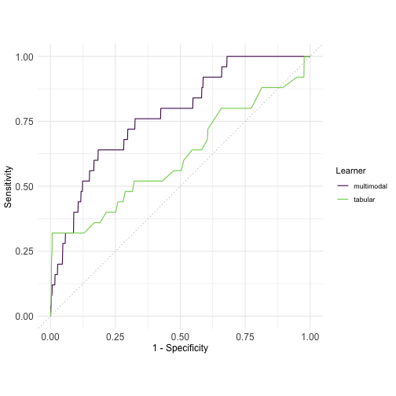

``` r
Sys.time()
```

```
## [1] "2026-10-20 14:06:38 CEST"
```

``` r
options(width = 70, useFancyQuotes = FALSE)
options(mlr3torch.cache = TRUE)
lgr::get_logger("mlr3")$set_threshold("warn")
library("mlr3torch")
```

```
## Loading required package: mlr3
```

```
## Loading required package: mlr3pipelines
```

```
## Loading required package: torch
```

``` r
set.seed(42)
torch_manual_seed(42)
mnist <- tsk("mnist")
mnist
```

```
## 
## ── <TaskClassif> (70000x2): MNIST Digit Classification ─────────────────────────────────────────────────────────────────────────────────────────────────────────────────────────────────────────────────────────────────
## • Target: label
## • Properties: multiclass
## • Features (1):
##   • lt (1): image
## • Target classes: 1 (11%), 7 (10%), 3 (10%), 2 (10%), 9 (10%), 0 (10%), 6 (10%), 8 (10%), 4 (10%), 5 (9%)
```

``` r
rows <- mnist$data(1:2)
rows
```

```
##     label           image
##    <fctr>   <lazy_tensor>
## 1:      5 <tnsr[1x28x28]>
## 2:      0 <tnsr[1x28x28]>
```

``` r
str(materialize(rows$image))
```

```
## List of 2
##  $ :Float [1:1, 1:28, 1:28]
##  $ :Float [1:1, 1:28, 1:28]
```

``` r
po_flat <- po("trafo_reshape", shape = c(-1, 28 * 28))
mnist_flat <- po_flat$train(list(mnist))[[1L]]
mnist_flat$head(2)
```

```
##     label         image
##    <fctr> <lazy_tensor>
## 1:      5   <tnsr[784]>
## 2:      0   <tnsr[784]>
```

``` r
str(materialize(mnist_flat$head(2)$image))
```

```
## List of 2
##  $ :Float [1:784]
##  $ :Float [1:784]
```

``` r
mlp <- lrn("classif.mlp",
  loss = t_loss("cross_entropy"),
  optimizer = t_opt("adamw", lr = 0.001),
  callbacks = t_clbk("history"))

mlp$param_set$set_values(
  neurons = c(100, 200), activation = nn_relu,
  p = 0.3, opt.weight_decay = 0.01,
  measures_train = msr("classif.logloss"),
  epochs = 10, batch_size = 32, device = "cpu")

mlp$configure(predict_type = "prob")

mlp$train(mnist_flat, row_ids = 1:1000)

mlp$model$network
```

```
## An `nn_module` containing 100,710 parameters.
## 
## ── Modules ─────────────────────────────────────────────────────────────────────────────────────────────────────────────────────────────────────────────────────────────────────────────────────────────────────────────
## • 0: <nn_linear> #78,500 parameters
## • 1: <nn_relu> #0 parameters
## • 2: <nn_dropout> #0 parameters
## • 3: <nn_linear> #20,200 parameters
## • 4: <nn_relu> #0 parameters
## • 5: <nn_dropout> #0 parameters
## • 6: <nn_linear> #2,010 parameters
```

``` r
head(mlp$model$callbacks$history, n = 2)
```

```
##    epoch train.classif.logloss
##    <num>                 <num>
## 1:     1              4.169792
## 2:     2              1.232116
```

``` r
pred <- mlp$predict(mnist_flat, row_ids = 1001:1100)
pred$score(msr("classif.ce"))
```

```
## classif.ce 
##       0.22
```

``` r
mnist_small <- mnist_flat$clone()$filter(1:1000)
rr <- resample(mnist_small, mlp, rsmp("cv", folds = 3))
rr$aggregate(msr("classif.ce"))
```

```
## classif.ce 
##  0.1719953
```

``` r
pth <- tempfile()
mlp$marshal()
saveRDS(mlp, pth)
mlp2 <- readRDS(pth)
mlp2$unmarshal()

set_validate(mlp, validate = 0.3)

nn_simple <- nn_module("nn_simple",
  initialize = function(d_in, d_latent, d_out) {
    self$linear1 <- nn_linear(d_in, d_latent)
    self$activation <- nn_relu()
    self$linear2 <- nn_linear(d_latent, d_out)
  },
  forward = function(x) {
    x <- self$linear1(x)
    x <- self$activation(x)
    self$linear2(x)
  }
)

net <- nn_simple(10, 100, 1)

net(torch_randn(1, 10))
```

```
## torch_tensor
## 0.01 *
## -9.4603
## [ CPUFloatType{1,1} ][ grad_fn = <AddmmBackward0> ]
```

``` r
module_graph <- po("module_1", module = nn_linear(10, 100)) %>>%
  po("module_2", module = nn_relu()) %>>%
  po("module_3", module = nn_linear(100, 1))

net <- nn_graph(module_graph,
  shapes_in = list(module_1.input = c(NA, 10)))
net(torch_randn(2, 10))
```

```
## torch_tensor
## -0.1218
## -0.0636
## [ CPUFloatType{2,1} ][ grad_fn = <AddmmBackward0> ]
```

``` r
graph <- po("torch_ingress_ltnsr") %>>%
  nn("linear", out_features = 100) %>>% nn("relu") %>>% nn("head")

md <- graph$train(mnist_flat)[[1L]]
md
```

```
## <ModelDescriptor: 4 ops>
## * Ingress:  torch_ingress_ltnsr.input: [(NA,784)]
## * Task:  mnist [classif]
## * Callbacks:  N/A
## * Optimizer:  N/A
## * Loss:  N/A
## * pointer:  head.output [(NA,10)]
```

``` r
graph <- graph %>>%
  po("torch_loss", t_loss("cross_entropy")) %>>%
  po("torch_optimizer", t_opt("adamw", lr = 0.001))

graph <- graph %>>%
  po("torch_model_classif", epochs = 10, batch_size = 16, device = "cpu")

glrn <- as_learner_torch(graph)
glrn$train(mnist_flat, row_ids = 1:1000)

path_lin <- nn("linear_1")
path_nonlin <- nn("linear_2") %>>% nn("relu")

residual_layer <- list(path_lin, path_nonlin) %>>% nn("merge_sum")

path_num <- po("select_1",
  selector = selector_type(c("numeric", "integer"))) %>>%
  po("torch_ingress_num") %>>%
  nn("tokenizer_num", d_token = 10)
path_categ <- po("select_2", selector = selector_type("factor")) %>>%
  po("torch_ingress_categ") %>>%
  nn("tokenizer_categ", d_token = 10)

graph <- list(path_num, path_categ) %>>% nn("merge_cat", dim = 2)

blocks <- nn("block", residual_layer, n_blocks = 5)

nn_winsorized_mse <- nn_module(c("nn_winsorized_mse", "nn_loss"),
  initialize = function(max_loss) {
    self$max_loss <- max_loss
  },
  forward = function(input, target) {
    torch_mean(torch_clamp((input - target)^2, max = self$max_loss))
  }
)
tloss <- as_torch_loss(nn_winsorized_mse)
tloss
```

```
## <TorchLoss:nn_winsorized_mse> nn_winsorized_mse
## * Generator: nn_winsorized_mse
## * Parameters: list()
## * Packages: torch,mlr3torch
## * Task Types: classif,regr,torch
```

``` r
gradient_clipper <- torch_callback("gradient_clipper",
  initialize = function(max_norm, norm_type) {
    self$norms <- numeric()
    self$max_norm <- max_norm
    self$norm_type <- norm_type
  },
  on_after_backward = function() {
    norm <- nn_utils_clip_grad_norm_(self$ctx$network$parameters,
      self$max_norm, self$norm_type)
    self$norms <- c(self$norms, norm$item())
  },
  state_dict = function() {
    self$norms
  },
  load_state_dict = function(state_dict) {
    self$norms <- state_dict
  }
)

nn_ffn <- nn_module("nn_ffn",
  initialize = function(task, latent_dim, n_layers) {
    dims <- c(task$n_features, rep(latent_dim, n_layers),
      output_dim_for(task))
    modules <- unlist(lapply(seq_len(length(dims) - 1), function(i) {
      if (i < length(dims) - 1) {
        list(nn_linear(dims[i], dims[i + 1]), nn_relu())
      } else {
        list(nn_linear(dims[i], dims[i + 1]))
      }
    }), recursive = FALSE)
    self$network <- do.call(nn_sequential, modules)
  },
  forward = function(x) self$network(x)
)

num_input <- list(x = ingress_num())
num_input
```

```
## $x
## Ingress: Task[selector_type(c("numeric", "integer"))] --> Tensor()
```

``` r
lrn_ffn <- lrn("classif.module",
  module_generator = nn_ffn,
  ingress_tokens = num_input,
  latent_dim = 100, n_layers = 5)

task <- tsk("mtcars")
task
```

```
## 
## ── <TaskRegr> (32x11): Motor Trends ────────────────────────────────────────────────────────────────────────────────────────────────────────────────────────────────────────────────────────────────────────────────────
## • Target: mpg
## • Properties: -
## • Features (10):
##   • dbl (10): am, carb, cyl, disp, drat, gear, hp, qsec, vs, wt
```

``` r
ingress <- po("torch_ingress_num")

embedding <- nn("tokenizer_num", d_token = 8)

block <- nn("multihead_attention", num_heads = 2) %>>%
  nn("layer_norm", dims = 1) %>>%
  nn("linear", out_features = 16) %>>%
  ppl("branch", list(relu = nn("relu"), sigmoid = nn("sigmoid"))) %>>%
  nn("dropout")

architecture <- embedding %>>% nn("block", block) %>>%
  nn("flatten") %>>% nn("head")

config <- po("torch_loss", loss = t_loss("mse")) %>>%
  po("torch_optimizer", optimizer = t_opt("adamw"))

model <- po("torch_model_regr", device = "cpu", batch_size = 32)

pipeline <- ingress %>>%
  architecture %>>% config %>>% model
learner <- as_learner_torch(pipeline)
learner$id <- "attention_nn"

library("mlr3tuning")
```

```
## Loading required package: paradox
```

``` r
learner$param_set$set_values(
  tokenizer_num.d_token = to_tune(c(4, 8, 16)),
  block.multihead_attention.num_heads = to_tune(c(1, 2, 4)),
  block.multihead_attention.dropout = to_tune(0, 0.5),
  block.linear.out_features = to_tune(c(8, 16, 32)),
  block.n_blocks = to_tune(1, 3),
  block.branch.selection = to_tune(c("relu", "sigmoid")),
  block.dropout.p = to_tune(0.1, 0.9),
  torch_optimizer.lr = to_tune(10^-4, 10^-1, logscale = TRUE))

set_validate(learner, "test")

learner$param_set$set_values(
  torch_model_regr.patience = 5,
  torch_model_regr.measures_valid = msr("regr.mse"),
  torch_model_regr.epochs = to_tune(upper = 100, internal = TRUE))

ti <- tune(
  tuner = tnr("random_search"),
  resampling = rsmp("holdout"),
  measure = msr("best_valid_score", minimize = TRUE),
  learner = learner,
  term_evals = 20,
  task = task)
tuned <- learner$param_set$search_space()$ids()
pvals <- lapply(ti$result_learner_param_vals[tuned],
  function(x) if (is.numeric(x)) signif(x, 3) else x)
cat(paste("*", names(pvals), "=", pvals,
  collapse = "\n"), "\n")
```

```
## * tokenizer_num.d_token = 16
## * block.n_blocks = 1
## * block.multihead_attention.num_heads = 2
## * block.multihead_attention.dropout = 0.0139
## * block.linear.out_features = 32
## * block.branch.selection = sigmoid
## * block.dropout.p = 0.871
## * torch_optimizer.lr = 0.00705
## * torch_model_regr.epochs = 13
```

``` r
library("torchdatasets")
dvc <- dogs_vs_cats_dataset("data", download = TRUE)

ds <- torch::dataset("dogs_vs_cats",
  initialize = function(pths) {
    self$pths <- pths
  },
  .getitem = function(i) {
    image <- torchvision::base_loader(self$pths[i])
    list(image = torch_tensor(image)$permute(c(3, 1, 2)))
  },
  .length = function() {
    length(self$pths)
  }
)

paths <- list.files(file.path("data", "dogs-vs-cats/train"),
  full.names = TRUE)
dogs_vs_cats <- ds(paths)

lt <- as_lazy_tensor(dogs_vs_cats, list(image = NULL))

labels <- ifelse(grepl("dog\\.\\d+\\.jpg", paths), "dog", "cat")
table(labels)
```

```
## labels
##   cat   dog 
## 12500 12500
```

``` r
tbl <- data.table(image = lt, class = labels)
task <- as_task_classif(tbl, target = "class", id = "dogs_vs_cats")
task
```

```
## 
## ── <TaskClassif> (25000x2) ─────────────────────────────────────────────────────────────────────────────────────────────────────────────────────────────────────────────────────────────────────────────────────────────
## • Target: class
## • Properties: twoclass
## • Features (1):
##   • lt (1): image
## • Target classes: cat (positive class, 50%), dog (50%)
```

``` r
augment <- po("augment_random_horizontal_flip", p = 0.5)

preprocess <- po("trafo_resize", size = c(224, 224))

normalize <- po("trafo_normalize",
  mean = c(0.485, 0.456, 0.406), std = c(0.229, 0.224, 0.225))

unfreezer <- t_clbk("unfreeze",
  starting_weights = select_name(c("head.weight", "head.bias")),
  unfreeze = data.table(epoch = 3, weights = select_all()))

convnext <- lrn("classif.convnext_tiny_1k",
  pretrained = TRUE, epochs = 5, device = "cpu", batch_size = 32,
  opt.lr = 1e-4, measures_valid = msr("classif.acc"),
  callbacks = list(unfreezer, t_clbk("history")))

learner <- as_learner_torch(
  augment %>>% preprocess %>>% normalize %>>% convnext)
learner$id <- "convnext"
set_validate(learner, 1 / 3)
learner$train(task, 12401:12600)
learner$model$classif.convnext_tiny_1k$model$callbacks$history
```

```
##    epoch valid.classif.acc
##    <num>             <num>
## 1:     1         0.3582090
## 2:     2         0.3731343
## 3:     3         0.9402985
## 4:     4         1.0000000
## 5:     5         1.0000000
```

``` r
task <- tsk("melanoma")
task
```

```
## 
## ── <TaskClassif> (32701x5): Melanoma Classification ────────────────────────────────────────────────────────────────────────────────────────────────────────────────────────────────────────────────────────────────────
## • Target: outcome
## • Properties: twoclass, groups
## • Features (4):
##   • fct (2): anatom_site_general_challenge, sex
##   • int (1): age_approx
##   • lt (1): image
## • Groups: patient_id
## • Target classes: malignant (positive class, 2%), benign (98%)
```

``` r
table(task$truth())
```

```
## 
## malignant    benign 
##       581     32120
```

``` r
task$missings("age_approx")
```

```
## age_approx 
##         44
```

``` r
path_tabular <- po("select_1",
    selector = selector_type(c("integer", "factor"))) %>>%
  po("imputehist") %>>%
  po("encode", method = "one-hot") %>>%
  po("torch_ingress_num") %>>%
  nn("tokenizer_num", d_token = 64)

patchify <- function(x) {
  nnf_unfold(x, kernel_size = 16, stride = 16)$transpose(2, 3)
}
path_image <- po("select_2", selector = selector_name("image")) %>>%
  po("torch_ingress_ltnsr", shape = c(NA, 3, 128, 128)) %>>%
  nn("fn_1", fn = patchify) %>>%
  nn("linear", out_features = 64)

po_torch_pos_embedding <- pipeop_torch("nn_pos_embedding",
  initialize = function(shapes_in) {
    self$weight <- nn_parameter(torch_randn(shapes_in[[1]][-1]) * 0.02)
  },
  forward = function(input) input + self$weight,
  shapes_out = function(shapes_in) shapes_in
)
path_image <- path_image %>>% po_torch_pos_embedding$new()

architecture <- list(path_tabular, path_image) %>>%
  nn("merge_cat", dim = 2) %>>%
  nn("block", nn("transformer_encoder_layer", nhead = 4,
    dim_feedforward = 128), n_blocks = 2) %>>%
  nn("fn_2", fn = function(x) x$mean(dim = 2)) %>>%
  nn("head")

model <- architecture %>>%
  po("torch_loss",
    t_loss("cross_entropy", class_weight = torch_tensor(10))) %>>%
  po("torch_optimizer", t_opt("adamw", lr = 0.0005)) %>>%
  po("torch_model_classif", epochs = 4, batch_size = 32, device = "cpu",
    predict_type = "prob")

preprocessing <- po("classbalancing", ratio = 4, reference = "minor",
    adjust = "minor") %>>%
  po("augment_random_horizontal_flip") %>>%
  po("augment_random_vertical_flip") %>>%
  po("augment_random_crop", size = c(128, 128), padding = 8)
glrn <- as_learner_torch(preprocessing %>>% model)

library("mlr3learners")
baseline <- as_learner(
  po("select",
    selector = selector_invert(selector_type("lazy_tensor"))) %>>%
  po("imputehist") %>>%
  lrn("classif.log_reg", predict_type = "prob"))
baseline$id <- "tabular"
glrn$id <- "multimodal"
task_subset <- task$clone(deep = TRUE)
ids <- partition(task_subset, ratio = 0.1)$train
task_subset$filter(ids)
design <- benchmark_grid(task_subset, list(glrn, baseline),
  rsmp("holdout"))
bmr <- benchmark(design)
library("mlr3viz")
plt <- autoplot(bmr, type = "roc")

library("ggplot2")
plt = plt +
  theme(
    axis.text.x = element_text(size = 12),
    axis.text.y = element_text(size = 12),
    axis.title.x = element_text(size = 12),
    axis.title.y = element_text(size = 12)
  )
print(plt)
```



``` r
ggsave(here::here("roc.png"), plt, width = 4, height = 4, dpi = 300)
Sys.time()
```

```
## [1] "2026-10-20 14:15:54 CEST"
```

``` r
sessionInfo()
```

```
## R version 4.5.3 (2026-03-11)
## Platform: aarch64-apple-darwin20
## Running under: macOS Tahoe 26.5.2
## 
## Matrix products: default
## BLAS:   /Library/Frameworks/R.framework/Versions/4.5-arm64/Resources/lib/libRblas.0.dylib 
## LAPACK: /Library/Frameworks/R.framework/Versions/4.5-arm64/Resources/lib/libRlapack.dylib;  LAPACK version 3.12.1
## 
## locale:
## [1] en_US.UTF-8/en_US.UTF-8/en_US.UTF-8/C/en_US.UTF-8/en_US.UTF-8
## 
## time zone: Europe/Berlin
## tzcode source: internal
## 
## attached base packages:
## [1] stats     graphics  grDevices datasets  utils     methods  
## [7] base     
## 
## other attached packages:
##  [1] ggplot2_4.0.3        mlr3viz_0.11.2       mlr3learners_0.16.0 
##  [4] torchdatasets_0.3.2  mlr3tuning_1.7.0     paradox_1.0.1       
##  [7] future_1.80.0        mlr3torch_0.3.3.9000 torch_0.17.0        
## [10] mlr3pipelines_0.12.0 mlr3_1.8.0          
## 
## loaded via a namespace (and not attached):
##  [1] gtable_0.3.6         xfun_0.61            processx_3.9.0      
##  [4] callr_3.8.0          vctrs_0.7.3          tools_4.5.3         
##  [7] Rdpack_2.6.6         safetensors_0.3.0    parallel_4.5.3      
## [10] tibble_3.3.1         pkgconfig_2.0.3      data.table_1.18.6.1 
## [13] checkmate_2.3.4      RColorBrewer_1.1-3   S7_0.2.2            
## [16] uuid_1.2-2           lifecycle_1.0.5      compiler_4.5.3      
## [19] farver_2.1.2         stringr_1.6.0        precrec_0.24.0      
## [22] codetools_0.2-20     bbotk_1.13.1         pillar_1.11.1       
## [25] crayon_1.5.3         parallelly_1.48.0    digest_0.6.39       
## [28] stringi_1.8.9        listenv_1.1.0        labeling_0.4.3      
## [31] mlr3measures_1.3.0   rprojroot_2.1.1      grid_4.5.3          
## [34] here_1.0.2           cli_3.6.6            magrittr_2.0.5      
## [37] future.apply_1.20.2  moocore_0.3.2        withr_3.0.3         
## [40] scales_1.4.0         backports_1.5.1      rappdirs_0.3.4      
## [43] bit64_4.8.6          matrixStats_1.5.0    globals_0.20.0      
## [46] jpeg_0.1-11          bit_4.6.0            otel_0.2.0          
## [49] evaluate_1.0.5       knitr_1.52           torchvision_0.10.0  
## [52] rbibutils_2.4.1      viridisLite_0.4.3    mlr3misc_0.23.0     
## [55] rlang_1.3.0          Rcpp_1.1.2           zeallot_0.2.0       
## [58] glue_1.8.1           renv_1.3.1           palmerpenguins_0.1.1
## [61] coro_1.1.0           jsonlite_2.0.0       lgr_0.5.2           
## [64] R6_2.6.1             fs_2.1.0
```

